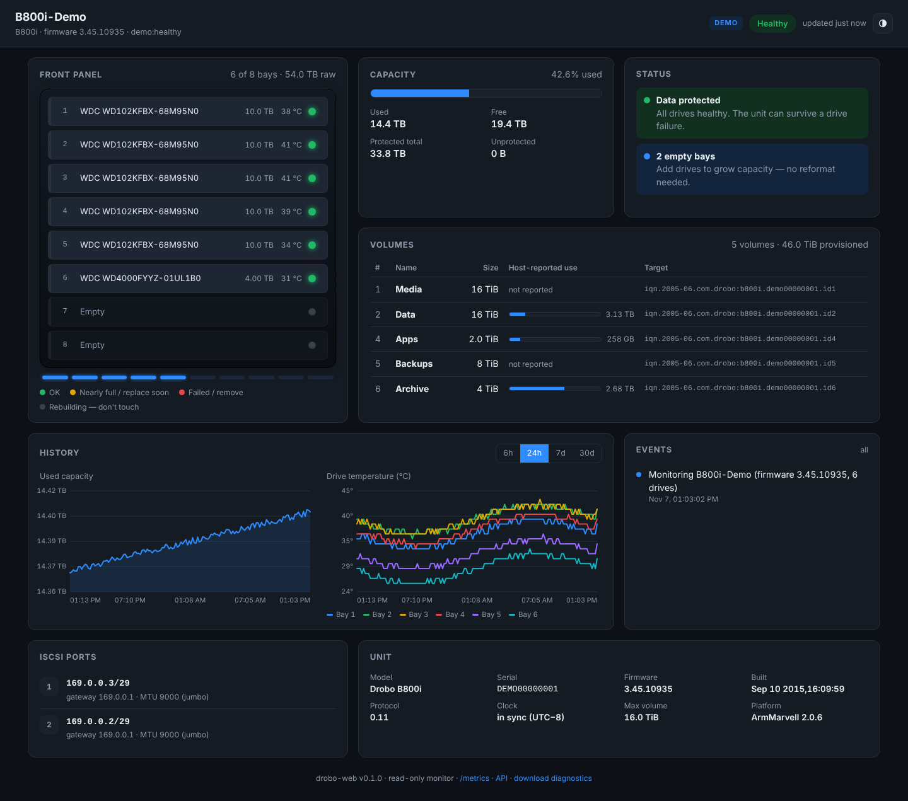
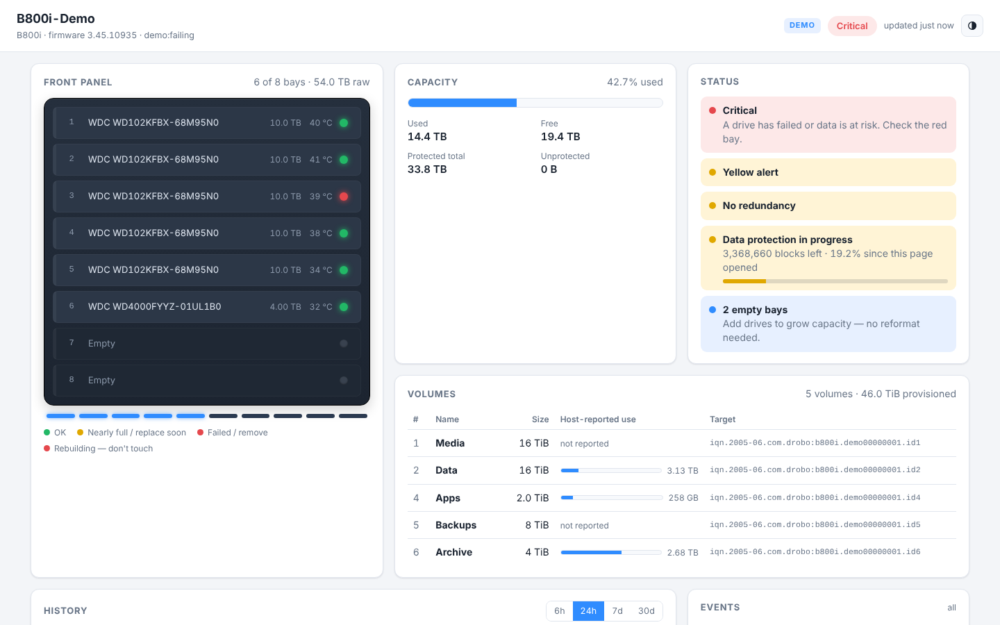

# drobo-web

A modern, read-only web dashboard for the **Drobo B800i** iSCSI SAN, running on Linux.

Drobo went out of business in 2023, and Drobo Dashboard only runs on Windows and macOS.
The B800i has no web interface or management IP: Dashboard manages it with vendor SCSI
commands sent inside an iSCSI session. drobo-web speaks the same commands from Linux and
shows the result in a browser, with history and alerts the original never had.

> **Which Drobos this is for.** drobo-web talks to the **B800i over its iSCSI ports**: every
> command travels inside an iSCSI session to the unit (TCP 3260), the same way Drobo Dashboard
> manages it. It doesn't work with the Ethernet NAS models that have their own management IP
> and file sharing (Drobo 5N, 5N2, B810n), or with USB, Thunderbolt or FireWire Drobos. Other
> iSCSI models (B810i, B1200i, DroboPro, DroboElite) may work but are untested; see the roadmap.



## Features

- **Front panel view**: all 8 bays with live lights (including the flashing rebuild
  states), drive model, size and **drive temperature**, plus the blue capacity gauge.
- **Capacity and volumes**: protected / used / free, each volume's size, target IQN and
  host-reported usage.
- **Status in plain words**: "Data protected", "No redundancy", relayout progress with a
  bar, empty bays.
- **iSCSI ports**: IP, prefix, gateway and MTU for both ports.
- **History**: used capacity and per-drive temperature over 6 h, 24 h, 7 d or 30 d (SQLite, 90-day retention).
- **Alerts**: drive failed, removed or inserted; health changes; redundancy lost; relayout
  started or finished; temperature and capacity thresholds; unit unreachable. Delivered by
  webhook (generic JSON, Discord, Slack, Teams, ntfy) and/or email.
- **Settings page**: alert email and webhooks (with a "send test alert" button), alert
  thresholds, polling, history retention, login, and usage reporting. Changes apply
  without a restart.
- **Prometheus** `/metrics` endpoint, plus a JSON API (`/api/docs`).
- **Read-only by default**: every SCSI command passes an allowlist (INQUIRY, MODE SENSE and the
  vendor volume-list read). The one exception is the opt-in volume-usage report that
  replaces Drobo Dashboard (see below). It never mounts or touches a volume.
- **Windows tray app** (`DroboWeb.exe`) that replaces Drobo's DDAssist.
- **No build step, no CDN**: it works on an isolated storage network.
- **Demo mode** replays a real B800i capture, so you can try it without hardware.



## Try it without a Drobo

```bash
pip install git+https://github.com/ddziubanski/drobo-web
droboweb serve --demo            # healthy unit
droboweb serve --demo failing    # bay 3 fails after 2 minutes (DROBOWEB_DEMO_SPEED=10 to hurry it)
# open http://localhost:8080
```

Or: `docker compose --profile demo up drobo-web-demo`, then go to http://localhost:8081.

## Windows: tray app (replaces DDAssist)

If your B800i is attached to a Windows machine, `DroboWeb.exe` replaces Drobo's DDAssist
tray app:

- The tray icon is coloured by health (green, amber, red, grey when unreachable). Hover it for
  the unit's status and capacity.
- Windows notifications for drive failures, redundancy loss, rebuilds, temperature,
  capacity and lost contact.
- Click the icon to open the full dashboard (served on `http://127.0.0.1:8780`, this PC only).
- **Settings…** opens the settings page: alert email, webhooks, thresholds, desktop
  notifications, start at login.
- **Start when I log in**: a scheduled task that starts it elevated, without a UAC prompt each time.
- **Report volume usage to the Drobo** (off by default): see below.

**Install:** download `DroboWeb.exe` from [Releases](https://github.com/ddziubanski/drobo-web/releases),
or the latest build from the
[windows-build workflow](https://github.com/ddziubanski/drobo-web/actions/workflows/windows.yml)
artifacts. Run it and accept the Administrator prompt: Windows only allows SCSI
pass-through to elevated programs, the same reason Drobo Dashboard's service runs as
SYSTEM. It finds the Drobo among your `PhysicalDrive`s by itself. Settings and the log
are in `%APPDATA%\DroboWeb`.

**Retire DDAssist:** Task Manager → Startup → disable "DDAssist". Exit it from its tray icon.

**Troubleshooting:** `droboweb-cli.exe list` (from an Administrator prompt) shows which
physical drives answer as a Drobo. `droboweb-cli.exe status` prints a one-shot status.
`DroboWeb.exe --demo` runs the tray with simulated data.

### Volume usage reporting (taking over from Drobo Dashboard)

The B800i is thin-provisioned. It can't see how full each volume's filesystem is, so the
host that has the volumes mounted tells it every few seconds. This is the **only write**
Drobo Dashboard makes during normal running, and it's what feeds the Drobo's used/free figures.

To uninstall Drobo Dashboard completely, turn on **Report volume usage to the Drobo** in
the tray menu (or set `DROBOWEB_REPORT_USAGE=1`). drobo-web then sends the same report:

- **Byte-for-byte Dashboard's format.** The tests rebuild the report captured from Dashboard and
  compare the bytes. The only write the SCSI layer will pass is this exact command and payload shape.
- **Usage comes from Windows**, mapping each iSCSI target to its disk and volumes
  (`Get-IscsiSession` → `Get-Disk` → `Get-Volume`). Volumes that aren't mounted on this PC are
  reported as 0, which the Drobo shows as "unknown", the same as Dashboard does.
- **It pauses itself** (and says why in the dashboard) when:
  - Drobo Dashboard's service (`DDService.exe`) is still running. Stop and disable
    "Drobo Dashboard Service" first, so the two don't both report.
  - None of the Drobo's volumes are mounted on this host. Otherwise a monitor-only machine would
    mark every volume as unknown.
- **Admin password:** drobo-web can't send the Drobo's admin password yet. Reading status works
  with a password set. If the dashboard says the unit rejected the usage report, turn the admin
  password off in Drobo Dashboard (Drobo Settings), then turn reporting back on.

On Linux it works the same way, using `/dev/disk/by-path` and the mounted filesystems.

## Use it with a real B800i (Linux)

### 1. Get an iSCSI session to the unit (on the Linux host)

> **Safety first.** A Drobo volume is a plain block device without cluster locking. If
> another server (for example the Windows box running Dashboard) has a volume mounted,
> **this host must never mount it**. Logging in and reading status is fine; mounting isn't.
> drobo-web never mounts anything. Install
> [`deploy/99-drobo-no-automount.rules`](deploy/99-drobo-no-automount.rules) so desktop
> auto-mounters stay away too.

```bash
sudo apt install open-iscsi lsscsi sg3-utils
sudo iscsiadm -m discovery -t sendtargets -p <B800i-IP>
```

Discovery lists one target per volume (`…b800i.<serial>.id1`, `.id2`, …). If it also
lists a target that isn't a volume, it's probably the management target. Please
[open an issue](https://github.com/ddziubanski/drobo-web/issues) with the output either
way (redact the serial), because this is still being worked out.

Log in to **one** target. Use the management target if there is one, otherwise the
volume least likely to be in use elsewhere:

```bash
sudo iscsiadm -m node -T <target-iqn> -p <B800i-IP>:3260 --login
sudo iscsiadm -m node -T <target-iqn> -p <B800i-IP>:3260 -o update -n node.startup -v automatic
```

### 2. Check that drobo-web can see it

```bash
pip install git+https://github.com/ddziubanski/drobo-web
sudo droboweb list      # shows /dev/sgN devices; the Drobo is marked "DROBO (protocol 0.11)"
sudo droboweb status    # one-shot text status
```

### 3. Run the dashboard

**Docker** (edit the device in `docker-compose.yml` first):

```bash
docker compose up -d drobo-web
```

**systemd**: see [`deploy/drobo-web.service`](deploy/drobo-web.service) and
[`deploy/drobo-web.env`](deploy/drobo-web.env).

**By hand**: `sudo droboweb serve --port 8080`

Root, or `CAP_SYS_RAWIO`, is needed because the kernel only passes vendor-specific
SCSI opcodes from processes with that capability.

## Configuration

Most settings can be changed on the **Settings page** (the gear icon on the dashboard, or
**Settings…** in the tray menu). Changes take effect immediately and are saved to
`droboweb-settings.json` next to the history database (`settings.json` in the tray app's
folder). The file can hold passwords, so it's created readable by its owner only.

Command-line flags win over environment variables, which win over the Settings page. A
setting fixed by a flag or a variable is shown on the page with a note, and can't be changed
there.

Editing is allowed from the computer drobo-web runs on, or from anywhere once a login is set
(`DROBOWEB_AUTH_USER` / `DROBOWEB_AUTH_PASSWORD`, or the page's Access section). Otherwise the
page is read-only, because it holds alert passwords and the usage-report write. Set
`DROBOWEB_SETTINGS_UI=on` to allow editing without a login on a trusted network, or `off` to
always make it read-only.

Environment variables:

| Variable | Default | |
|---|---|---|
| `DROBOWEB_DEVICE` | `auto` | `/dev/sgN`, or `auto` to probe iSCSI-attached devices |
| `DROBOWEB_PORT` / `DROBOWEB_HOST` | `8080` / `0.0.0.0` | |
| `DROBOWEB_POLL_SECONDS` | `10` | how often the unit is polled |
| `DROBOWEB_SAMPLE_SECONDS` | `60` | how often a history point is stored |
| `DROBOWEB_DB_PATH` | `droboweb.sqlite3` | history and events |
| `DROBOWEB_RETENTION_DAYS` | `90` | |
| `DROBOWEB_SETTINGS_PATH` | next to the database | file the Settings page saves to |
| `DROBOWEB_SETTINGS_UI` | `auto` | `auto` (editable with a login or from this computer), `on`, `off` |
| `DROBOWEB_TEMP_WARN_C` | `50` | drive temperature alert |
| `DROBOWEB_CAPACITY_WARN_PCT` | `85` | capacity alert |
| `DROBOWEB_AUTH_USER` / `_PASSWORD` | (empty) | HTTP basic auth for the UI and API (`/healthz` stays open) |
| `DROBOWEB_NOTIFY_MIN_SEVERITY` | `warning` | `info`, `warning` or `critical` |
| `DROBOWEB_WEBHOOK_URL` / `_FORMAT` | (empty) / `json` | `json`, `discord`, `slack`, `teams`, `ntfy` |
| `DROBOWEB_SMTP_HOST`, `_PORT`, `_USER`, `_PASSWORD`, `_STARTTLS`, `DROBOWEB_MAIL_FROM`, `DROBOWEB_MAIL_TO` | | email alerts |
| `DROBOWEB_DEMO` / `DROBOWEB_DEMO_SPEED` | (empty) / `1` | `healthy` or `failing` |
| `DROBOWEB_FIXTURE` | (empty) | replay a fixture file instead of real hardware |
| `DROBOWEB_REPORT_USAGE` / `DROBOWEB_USAGE_SECONDS` | `false` / `30` | send the host's volume usage to the unit (replaces Drobo Dashboard) |

## CLI

```
droboweb serve   [--device /dev/sgN | --demo [healthy|failing] | --fixture FILE] [--port N]
droboweb tray    [--demo]          # tray icon + notifications (pip install "drobo-web[tray]")
droboweb status  [--json] [same source options]
droboweb list    [--all]          # which /dev/sg* devices are Drobos
droboweb dump    [-o FILE] [--no-redact]   # raw responses, for bug reports and new fixtures
```

## Status and roadmap

| | |
|---|---|
| ✅ | Read-only status: bays, lights, temperatures, capacity, volumes, ports, firmware, flags |
| ✅ | History, alerts, Prometheus, demo mode |
| ✅ | Windows tray app (DDAssist replacement); volume-usage report (Dashboard replacement), opt-in |
| ✅ | Settings page for drobo-web's own settings (alerts, thresholds, polling, login) |
| ⏳ | First run on real hardware (Windows pass-through and the usage report are built to the capture, not yet run against a unit) |
| ⏳ | Confirm which iSCSI target Linux should use for management (needs a discovery listing) |
| ⏳ | Map the unknown status bits and option flags |
| 🔜 | Unit settings and actions Dashboard has (rename, network, admin password, Blink Lights). Network, admin password and Blink Lights are mapped in PROTOCOL.md; they will be opt-in and off by default |
| 🔜 | Other models (B810i, B1200i, DroboPro, DroboElite): send a capture or a `droboweb dump` |

The protocol notes are in [PROTOCOL.md](PROTOCOL.md).

## Contributing a capture

On Windows with Dashboard: capture the iSCSI NIC in Wireshark (`tcp port 3260`) while
Dashboard is open, then:

```bash
python3 tools/pcap_to_fixture.py capture.pcapng -o my-unit.json   # needs tshark; redacts by default
```

On Linux: `sudo droboweb dump -o my-unit.json`.

Open an issue and attach the JSON. Both tools replace the serial, IQNs, unit name and
volume names. Check the file yourself before posting.

## Credits and license

GPL-3.0-or-later. Protocol groundwork from [drobo-utils](https://github.com/petersilva/drobo-utils)
(Peter Silva and contributors, GPL-3.0). This project isn't affiliated with Drobo, Inc. or StorCentric.
"Drobo" is used only to name the hardware this software works with.
